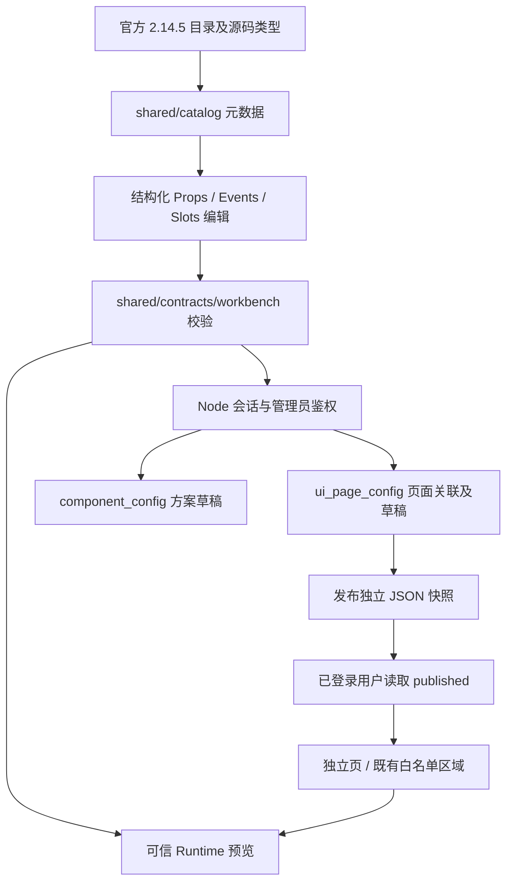

# 组件工作台架构：V1 兼容与 V2 页面发布

更新：2026-10-15。三组件的 Phase A 原型已扩展为 Element Plus 工作台；本文描述当前落盘实现。自动化、真实数据库和浏览器分别验收，不能以目录数量或预览成功代替完整用户链路。

## 业务与管理分工

首页、归档、想法卡片和详情保留原有业务。`IdeaEntryForm` 负责受控输入、提示词与表单反馈；`IdeaEntryPanel` 编排草稿、会话、验证、创建请求和结果。首页和已发布的业务节点复用 Panel，避免为每个 Element Plus 控件创建 Base 包装。

顶部用户名菜单提供个人资料、退出和管理员专属管理入口。管理区采用固定 `AdminLayout`，收拢用户管理、组件目录和方案工作台；普通用户不读取管理草稿。路由元数据集中维护菜单和角色，Node 仍逐请求检查真实会话，前端隐藏菜单不充当权限边界。

| 页面 | 固定路由 | 使用人 |
| --- | --- | --- |
| 个人资料 | `/profile` | 已登录用户，仅改本人昵称 |
| 用户管理 | `/admin/users` | 管理员 |
| 全库目录 | `/admin/catalog` | 管理员 |
| 方案工作台 | `/admin/workbench` | 管理员 |
| 已发布独立页 | `/pages/:pageKey` | 已登录用户 |

旧 `/components`、`/admin/components` 仅重定向至管理区。没有数据库动态 import、任意路由模块或脚本执行入口。

## 从元数据到渲染

`shared/catalog/element-plus.ts` 由版本固定的官方文档、源码和安装类型生成并审计，覆盖官方 82 条目录。条目附用途、选型条件和限制；公开 API 分成组件、服务、指令、设计规范及内部对象/实例接口。目录条目数量不等于可独立渲染组件数量：Border/Color/Typography 使用设计规范适配，Layout 等组合条目选择其真实根组件，内部 Column/TabNav 等接口通过所属属性或公开 ref 路径使用。

Node 不导入 Vue。静态元数据、真实运行时导出白名单及图标白名单决定允许的能力；数据库描述不能新增可执行实现。详情见 `element-plus-api-coverage.md`，其中元数据覆盖和实际行为验证分别记录。

## Schema 与实例状态

`shared/contracts/component-config.ts` 保留 V1 input/textarea/button 契约。`shared/contracts/workbench.ts` 新增 V2，明确 `schemaVersion / libraryKey / libraryVersion`、节点、状态初值和注册资源。旧记录不在初始化时自动转换，V1 仍可读取；管理员显式从工作台保存 V2 时才迁移该实例。

V2 的属性使用类型化值：literal、数组/对象、Date、受限 RegExp、图标、已注册组件、VNode、callback、DOM/ref、HTML 和 style。Function 通过可信回调策略表达，事件通过注册动作表达，不保存可执行 JS。策略具有受控参数；resolve 回调显式配置成功/失败参数索引，避免把 reject 当 resolve。不同验证器与筛选器使用匹配真实 API 的结果模式。

`for` 的 item/index 和插槽公开参数形成词法作用域。绑定只能引用已声明状态、资源、合法作用域、范围内事件参数或公开本人身份；状态写入只允许 state/scope。方法引用必须属于目标组件的公开 Exposes；内部 ref 还检查所属父 API 和公开路径。必填属性、枚举、对象成员、别名重复、双向 update 事件、未知键和原型字段均被校验。

`schema.state` 保存管理员设定的默认状态；浏览器输入和预览交互仅改变当前运行实例，不自动覆盖数据库配置。普通用户的 Idea 正文继续通过原业务 API，`current-user-ideas` 数据源始终使用当前登录会话，不接受任意 owner。上传适配提供受控预览；没有任意 URL 请求执行器。

## 保存、发布与两类挂载

| 表 | 职责 |
| --- | --- |
| `component_definition` | 已安装能力元数据；V1 与版本化 V2 注册项分开标识 |
| `component_config` | 可复用方案；V1/V2 JSON、revision 和创建/更新身份时间 |
| `ui_page_config` | 目标区域、页面草稿版本和独立发布名称/JSON/版本/时间 |

定义与实例是逻辑关联，未增加物理外键和 REFERENCES 权限。建表与增量初始化在 `backend/db/schema.sql`、`backend/db/setup.ts`。既有账号和 Idea 不清空、不重新分配。

模板保存不会自动发布。页面关联复制方案为独立草稿，更新须携带 `expectedRevision`；事务行锁检查并递增版本，过期保存/发布返回 409。旧版编辑器也递增相同版本，避免跨编辑器覆盖。发布复制当前名称与 Schema 到独立快照，后续模板或页面草稿修改不改变用户正在读取的版本。

独立页使用代码固定的 `/pages/:pageKey`。既有区域只接受下列注册目标：

| pageKey | regionKey |
| --- | --- |
| home | after-entry |
| archive | before-list / after-list |
| ideas | before-grid / after-grid |
| idea-detail | after-detail |

目标创建后不可通过更新接口改写；同一目标只有一份页面关联。首页本身已有录入面板，扩展区拒绝从 root、状态、资源或回调间接重复嵌入业务录入节点，普通 literal JSON 不会误判成节点。

## API

下表为 Node 路径；浏览器通过同源 `/api` 前缀代理访问。

| 权限 | 请求 | 行为 |
| --- | --- | --- |
| 管理员 | GET `/admin/catalog` | 完整已安装可信目录 |
| 管理员 | GET / POST `/admin/templates` | 列表 / 创建 `{schema}` |
| 管理员 | GET / PUT `/admin/templates/:id` | 详情 / 更新 `{schema, expectedRevision}` |
| 管理员 | GET / POST `/admin/page-configs` | 列表 / 创建 `{name, target, schema}` |
| 管理员 | GET / PUT `/admin/page-configs/:id` | 详情 / 更新 `{name, schema, expectedRevision}` |
| 管理员 | POST `/admin/page-configs/:id/publish` | 发布 `{expectedRevision}` |
| 已登录 | GET `/ui/pages/:pageKey` | 独立页已发布快照 |
| 已登录 | GET `/ui/regions/:pageKey/:regionKey` | 白名单区域已发布快照 |
| 已登录 | PATCH `/auth/profile` | `{nickname}`，只修改本人昵称 |

旧 `GET /component-definitions`、`GET /component-configs`、详情及旧写接口均改为管理员权限。此为用户确认的新管理范围；普通用户通过 published runtime 读取发布内容。没有删除接口。

创建 201、更新/发布 200、非法输入 400、匿名/失效会话 401、角色不足 403、不存在或未发布 404、版本或目标冲突 409、请求过大 413、数据库故障/损坏存储 503。runtime 响应只有发布字段，不含草稿版本和内容。

## 安全与兼容边界

所有写入使用参数化 SQL，归属和审计人来自真实会话。昵称以 Unicode 字符计数，trim 后 1–40 字符，禁止控制/隐藏字符；不修改登录 username、角色、密码或 userId。Idea 接口字段与个人隔离保持原契约。

方案 JSON 上限为 UTF-8 128 KiB；管理配置 HTTP 上限 256 KiB，Idea/认证保持 16 KiB。另限制节点、层级、资源及类型化值数量，共享预算不能通过嵌套作用域重置。

URL、样式、HTML/SVG、正则和 DOM 引用使用受控边界。HTML 仅安全排版子集，Loading SVG 仅几何标签/静态属性；浏览器再用 DOMPurify。动态绑定与回调结果在使用点重新校验，不能仅验证初始静态 JSON。未知/危险配置拒绝保存或局部显示错误；列表读仍采用整批存储校验，尚不支持损坏列表部分返回。

Cookie 会话由 Passport/express-session 及 MySQL 管理。TTL 到期、禁用或 auth_version 变化会销毁旧会话并返回 401；旧响应不清除或重发旧 SID，避免晚到后覆盖刚建立的新登录。携带失效 Cookie 可以直接重新登录，失败凭据不产生匿名 SID；显式退出继续清 Cookie。前端会话代次另行阻止旧 HTTP 结果写入新账号状态。

非预期错误只记录安全结构化诊断：固定路由模板、允许的 method、错误代码白名单和固定错误类型，不记录 SQL、参数、密码、动态 URL、请求体或 error message/stack。

## 启动与验证

按 README 配置本机 `.env.local`、专用 MySQL 账号与随机 SESSION_SECRET，执行 `npm ci`、`npm run db:init`、`npm run dev`。迁移需要项目库 SELECT/INSERT/UPDATE/DELETE/CREATE/ALTER，日常运行无需使用 root。配置文件不提交，SMTP 未配置不算真实邮箱验收通过。

完整步骤和本次已执行证据见 `testing-component-config.md`。拖拽、任意组件库和数据库动态菜单不在本次实现范围；元数据/契约通过不能替代所有高级 API 的真实交互验收。
