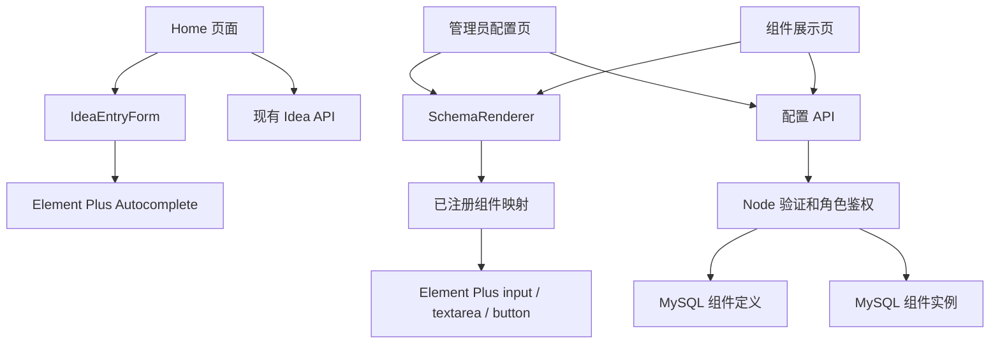

# Phase A：业务组件与配置复用

本轮按桌面 `file.txt` 渐进实施配置式创建。目标是让管理员选择已注册的 Element Plus 能力、编辑配置、预览、保存到 MySQL，再由独立的「组件」页面读取和复用。首页继续承担记录 Idea 的业务入口。

## 审计与范围

审计时 Home 的职责包括自动补全、表单状态、验证、提交和通知。API 请求已经集中在 `src/api`，共享 Idea 契约、Repository、会话与管理员权限已经存在，可以保留。归档、卡片、只读详情也不需要为了组件化而重新实现。

| 决策 | 模块 | 本轮职责 |
| --- | --- | --- |
| 保留 | Idea API、归档、详情、账户体系 | 接口字段与个人数据隔离保持兼容 |
| 重构 | Home 与 IdeaEntryForm | 表单负责输入、提示词、受控值与提交事件，页面负责草稿和 HTTP 提交 |
| 新增 | 共享 Schema、组件元数据、前端 Registry | 描述配置规则，白名单映射到 Element Plus，验证后再渲染 |
| 新增 | 管理配置页、组件展示页、Node 配置 API | 管理员写配置；登录用户加载复用；输入内容本身不被配置保存接口提交 |
| 新增 | 定义表与实例表 | 分别保存系统能力描述和页面使用配置，版本标识明确 |
| 重构 | 静态路由元数据与菜单生成 | 固定页面注册、菜单顺序、角色与激活项集中管理 |
| 暂缓 | 拖拽、任意库、动态菜单、工作流 | Phase B/C 扩展方向，不在本轮实现 |

现有单个较小的首页不需要十几个 `BaseXXX`。抽取 IdeaEntryForm 的价值是复用真实业务表单，而不是给每个 Element Plus 组件增加一层包装。

## 复用与边界

组件定义描述系统提供什么能力，例如输入组件允许哪些属性。组件实例描述一次具体使用，例如名称、字段、占位文字与校验。相同定义可被多个实例复用；数据库没有 Vue 源码，也没有动态 import 路径。

首轮支持 `input`、`textarea`、`button`；`libraryKey` 只接受 `element-plus`。Schema 固定版本，属性与字段逐项检查，未知属性、动态事件和脚本不可透传。按钮仅允许一个已注册的 `click / show-message` 动作；消息作为文本显示。不存在 eval、Function 或任意数据库字符串加载组件的入口。

SchemaRenderer 对异常配置显示局部错误，其他已加载实例继续渲染。实例预览的值只存在浏览器组件状态中，不改变已保存配置或 Idea 正文。Idea 自动补全由专用业务组件保留，异步回调不序列化到数据库。

本轮 Repository 采用整批验证：数据库中某个损坏实例会令列表读取返回安全 503，展示页显示加载错误；合法实例的单独详情仍可读取。这不会导致应用崩溃，但尚未实现逐条隔离损坏记录、部分返回正常列表的策略。

## 权限与路由

参考 RuoYi-Vue3 的静态与权限路由分离、路由元数据驱动菜单的思路，采用符合项目规模的固定路由列表。页面只能来自代码中明确注册的组件。没有从数据库任意路径加载模块，也没有引入完整动态菜单系统。

路由角色和菜单可见性用于前端体验。Node 仍以真实会话检查身份和管理员角色；普通用户即使直接请求写入接口，也必须得到 403。配置属于管理员发布的共享 UI 配置，不等同于用户的私有 Idea 数据。

## 数据库与兼容性

新增定义和实例表，通过增量 SQL 创建；现有 Idea 行不修改，不重新分配归属。配置接口沿用 mysql2 和 Repository，使用参数化查询。前后端共享结构验证；后端验证才是写入的最终边界。

这轮不增加删除 API；管理员可创建、更新实例，用户只读。旧的 `POST /idea`、`GET /ideas`、`GET /ideas/:ideaId` 保留 `ideaId / ideaContent / createdTime`。登录不恢复已移除的 Origin 校验。

已有构建缺陷来自 session store 类型声明固定旧版 mysql2，与项目连接池类型冲突。本轮只在适配层通过第三方构造参数类型表达兼容连接；不升级依赖，不改用户正在维护的 pnpm 配置。

## 验收方法

自动化测试验证公开行为：Idea 表单受控输入、自动补全、校验、防双击、HTTP 成功及失败；Schema 危险属性、版本、字段边界；Registry 局部降级和文本转义；管理员权限、错误响应；配置保存与重新加载；菜单角色和页面白名单。

真实 MySQL smoke 单独执行，只创建随机名称的临时用户和配置，记录精确 ID 后清理。邮件使用进程内替身，不发送外部邮件。现有 Idea 内容与归属在运行前后保持一致。浏览器再手动检查配置创建→预览→保存→展示→刷新，以及 Idea 核心流程；截图由主代理保存。

详见 `testing-component-config.md`。未执行的检查只写待验收，不标记成功。

## 后续扩展

Phase B 可以复用注册表和实例 Schema 加入拖拽布局；新增组件必须同时增加元数据、允许的属性、运行时验证与渲染映射。真正引入数据库菜单时，再增加菜单契约和固定页面注册映射，不把路径直接当模块地址执行。
