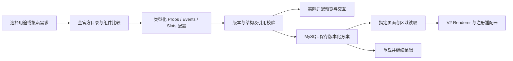

# 全库 Schema 工作台与页面动态渲染：已确认范围及实施设计

日期：2026-10-14。状态：**历史设计快照**。本文件保留当时确认的范围、建议和讨论事实；2026-10-15 已进入实现及验收阶段。当前实际架构、启动和接口说明见 [组件配置实施文档](./component-config-phase-a.md)，最新执行证据见 [2026-10-15 开发日志](./development-logs/2026-10-15-完善组件配置工作台.md)。

本文件承接用户对产品方向的纠正，不改写原 Phase A 的历史实施说明。形成这份快照时仅讨论和记录设计，尚未修改业务源码、测试、数据库或 Git；下文的建议措辞保留该时点语境，不作为当前实施状态或验收结论。

## 1. 已确认的产品范围

用户已明确回答全部四个范围问题：

1. **主要产物是 Schema**：管理员把方案保存到 MySQL，项目页面加载后动态渲染。现在不建设代码生成产品，也不把复制 Vue SFC 作为主链路。
2. **首版覆盖全库与完整 API**：以 Element Plus 官方总览为目录，每个条目对应的完整 Props、Events、Slots 都有可视化配置与预览。不能将范围降为仅名称目录、三个适配器、常用属性子集，或把高级能力留作灰色按钮。
3. **个人资料修改昵称**：新增可编辑昵称；登录 username 保持不变，用户 ID 与 Idea 归属不变。
4. **两种页面挂载都要**：独立的配置页面可读取 Schema 动态渲染；现有项目页面也可绑定指定区域。两种方式共享保存、发布和运行体系。

另外已明确：管理三个页面进入独立管理区；账号名称旁使用官方 SVG 下三角和下拉菜单；所有登录用户可进入个人资料、退出；管理入口仅管理员可见，Node 独立验证管理权限。原有 Idea、登录、草稿保护和 MySQL 定义/实例分离继续保留。

### 范围确认后的技术建议

独立页面采用固定 DynamicPage 组件和建议路由 `/pages/:pageKey`；现有页面采用 existingPageRegistry 与区域白名单。具体标识、区域位置、发布数据结构是本文件提出的可评审实现建议，不再重复询问这四个已回答的问题。后台预览仍不能替代两种真实页面挂载验收。

## 2. 本地基线与全库范围

### 版本与条目事实

本地 package.json 声明 element-plus 为 ^2.14.5；实际安装版本为 **2.14.5**。2026-10-14 核对的官方总览包含七组 **82 个条目**：基础 12、配置 1、表单 25、数据展示 23、导航 9、反馈 10、其他 2。[官方总览](https://element-plus.org/zh-CN/component/overview.html)

这不是 82 个都能直接创建的 Vue 组件。Border、Color、Typography 是三个设计规范条目；另外有服务、指令和组合用法。逐项核对本地安装包，其余 79 个条目的相应模块声明均存在；Layout 映射到 Row/Col，DateTime Picker 对应 Date Picker 的使用变体。Input OTP、Splitter、颜色与日期面板也有本地声明。**模块存在只证明基本映射可用，不证明已适配或每项 API 已核验。**

建议以明确的 2.14.5 运行目标建立完整 API 基线，结合官方文档、对应发布版本源码及本地类型声明校对。网站新增 API 若高于本地版本，必须记录具体版本差异并评审真实升级，不能默默隐藏属性或把不兼容代码标为支持。

### 每个条目必须建立的审查行

| 维度            | 必须记录与核对的内容                                                             |
| --------------- | -------------------------------------------------------------------------------- |
| 目录            | 稳定 key、官方名称、类别、文档地址、用途、性质、目标版本、官方来源与核对日期     |
| Props           | 每个公开属性的类型、默认值、必需性、允许值、版本、编辑器、序列化与运行时解析规则 |
| Events          | 每个事件的名称、参数结构、绑定界面、可用动作、回调结果/异步语义与预览用例        |
| Slots           | 每个命名槽、作用域参数、默认内容、允许子节点、绑定编辑器和预览用例               |
| Exposes/Methods | 文档公开的方法或实例能力映射为受控动作，支持相关的完整交互                       |
| 预览            | 正常状态、必要边界、关联属性、事件与槽位用例，副作用清理方式                     |
| 完成证据        | 元数据集合比对、Schema 往返、实际预览/挂载行为和版本兼容记录                     |

目录与公开 API 均采用**集合相等**检查，不能用一个总数量或重复属性抵消缺项。类型声明中的内部实现属性不能混入公开目录；文档特有的 Slots、作用域类型、说明和版本需人工补充。所有条目与所有公开 API 是首版验收范围，实施状态暂未完成也不能变成产品里的永久不可用入口。

## 3. 纠正当前实现方向

| 当前实现                      | 继续保留的价值                                 | 必要变化                                                                     |
| ----------------------------- | ---------------------------------------------- | ---------------------------------------------------------------------------- |
| IdeaEntryForm + Home          | 受控输入、提示词、共享验证、API 编排及草稿归属 | 保留，不因工作台重写 Idea                                                    |
| 三种 V1 Schema                | 已保存实例与已有接口兼容                       | 新建 V2 全库模型；不能直接假称 V1 已支持全 API                               |
| registry.ts 与 SchemaRenderer | 白名单映射、局部错误及消息文本安全             | 扩展为组件、服务/指令、设计规范适配；接收版本分派结果                        |
| ComponentConfigView           | 管理员保存、重载和错误反馈                     | 替换通用 JSON 表为类型对应的 Props/Events/Slots 交互与完整预览               |
| ComponentsView                | 加载实例                                       | 演进为全库目录；已保存方案与实例预览进入工作台，业务挂载另按用户指定区域实现 |
| 固定路由与 meta               | 页面注册与菜单同源，角色护栏                   | 引入独立 AdminLayout；保留固定页面注册，不使用数据库字符串动态 import        |
| 配置 GET 接口                 | 能加载方案                                     | 后台管理读取与写入都按管理员鉴权；业务区域使用单独、明确的挂载读取契约       |
| username                      | 唯一登录标识与已保存账号                       | 新增昵称，不改变 username、密码、角色或 userId                               |

## 4. Schema 主链路与全 API 配置方式



用途筛选采用可审查标签和规则，开发者也可直接按名称选择；不默认依赖 AI。编辑、预览、保存、重新加载、业务挂载使用同一份 Schema 语义，不能预览用一份手写 demo、保存另一份不工作的配置。

### Props：完整类型覆盖，使用对应的可视化编辑器

| 官方类型/用途                     | 可视化配置及保存表达                                   | 运行时要求                                                   |
| --------------------------------- | ------------------------------------------------------ | ------------------------------------------------------------ |
| boolean、number、string、enum     | 开关、数值、文本、枚举控件；显示默认值与范围           | 显式按元数据转换，区分未设置、空值与默认值                   |
| modelValue 与其他双向属性         | 状态字段、初值、类型与更新事件绑定                     | 实例拥有状态；正确承接 update 事件，不将预览输入值写回定义表 |
| object、array、选项、列、树、规则 | 结构化增删/排序/字段编辑及示例数据；高级 JSON 只是辅助 | 子字段校验、引用验证，保留 API 要求的数据结构                |
| Date、RegExp 等非 JSON 值         | 明确的类型标记、日期/规则编辑器或注册规则引用          | 显式复原类型，不能猜测所有字符串或执行 JS 表达式             |
| Component、VNode、渲染函数        | 已注册组件引用，或可编辑的安全节点/渲染模板引用        | 从白名单创建组件或 VNode；不从名称拼接 import                |
| Function、异步回调                | 参数/结果元数据、注册回调选择、关联数据/动作配置       | 调用可信回调实现，匹配参数、返回值和 Promise/resolve 语义    |
| DOM、容器、目标引用               | 可视化选择已注册页面区域或预览目标                     | 解析受控 targetRef，不存原生 DOM、不执行任意选择器脚本       |

每个公开属性都需要有实际可用的配置表达与预览路径；不能把 Function、VNode、DOM 类型全部删掉后宣称全 API。它们以受控引用和配置化构造表达，不意味着允许用户把任意函数源码写进数据库。

异步搜索、上传请求、表单验证、表格排序/格式化、树懒加载等，都应按实际 API 的参数和结果设计注册适配。适配器可由开发者在可信代码里扩展，元数据与可视化配置随注册能力一起提供。只提供一个无行为空函数或一个固定示例回调，不算对应 API 完整预览通过。

### Slots：可嵌套节点与作用域绑定

槽位编辑器必须呈现真实名称、作用域参数和子组件需求。Schema 的每个槽位保存节点列表；节点可为文本、已注册组件、条件/列表节点或安全渲染模板引用。普通插槽与作用域插槽不能用一个字符串字段替代。

作用域引用采用结构化绑定，例如来源为当前 slot、路径为 row.name；v-for 的 item/index、当前实例状态、选项数据也有显式命名空间。编辑器让开发者选择来源与路径，检查作用域是否存在和目标类型是否匹配。不保存可执行模板字符串或 JS 算术表达式。

表格单元格、Dropdown 菜单、表单子项、图标插槽等必须能组合并实际预览。合法的组件层级、递归上限与资源配额是安全校验，不是把所有 children 固定为空数组。嵌套节点的修改保持稳定 nodeId，防止错误复用其他实例的状态。

### Events、Callbacks、Actions：彼此区分

- Events 是组件发出的通知，保留事件名与参数定义，可绑定多个有顺序的注册动作。
- Callbacks 是组件调用并可能要求返回值/Promise/resolve 的函数参数，例如校验、懒加载、请求、格式化；不能当成只会弹消息的事件。
- Actions 是可信实现的行为，包括更新状态、调用已注册数据源、调用实例公开方法、打开/关闭反馈等。每类动作有参数、输出与错误语义。

Schema 只保存 callbackRef/actionRef、参数和数据绑定；结果可进入实例状态或后续动作。配置界面提供真实可用的选择和映射，预览检查动作链、返回类型、异步 Loading 与错误行为。注册器没有对应实现时必须补齐可信实现，不能把这个公开 API 留作首版灰色项。

## 5. 三种 kind 的适配及完整预览

| kind              | 处理范围                                                                     | 完整配置与预览要求                                                                                                      |
| ----------------- | ---------------------------------------------------------------------------- | ----------------------------------------------------------------------------------------------------------------------- |
| component         | Vue 组件、组合子组件与使用变体                                               | Props、Events、Slots 及相关公开方法全部记录；嵌套结构、模型值、作用域与异步回调实际运行                                 |
| service/directive | Message、MessageBox、Notification、Loading、Infinite Scroll 等调用或指令形式 | 呈现真实 Options、回调、生命周期/方法与指令绑定；注册服务调用，确认/取消/关闭/卸载都有清理；不能伪造不存在的组件标签    |
| design            | Border、Color、Typography 等规范条目                                         | 提供规范实际描述的样式参数、主题变量及预览，不伪造 Events/Slots；公开 API 不适用时标为“不适用”，而不是“高级 API 未支持” |

Loading 的官方 API 包含指令与服务，MessageBox 是函数调用，Typography 是排版规范。[Loading](https://element-plus.org/zh-CN/component/loading.html)、[MessageBox](https://element-plus.org/zh-CN/component/message-box.html)、[Typography](https://element-plus.org/zh-CN/component/typography.html)

设计参数优先在实例容器作用域内应用；页面级主题能力经对应注册适配器作用于批准的页面根区域。预览使用明确注册的测试数据源/请求能力来演示完整行为，不能因预览而偷偷操作真实 Idea、外部邮件或未知上传服务。

完整 API 支持不等于不安全值原样执行。HTML、SVG、样式、URL、正则等需要与各 API 对应的验证/安全转换；危险脚本不允许穿过引用系统。合法功能要有可配置路径，不能以简单删属性掩盖适配缺失。

## 6. V1 到 V2 的兼容迁移

### 建议的 V2 结构边界

定义仍描述系统已经安装的能力；实例/方案仍描述一次使用。V2 增加 kind、完整 prop 值表达、模型状态、命名槽节点、事件动作与回调引用；采用版本分派，不在 V1 类型中塞入任意 unknown props。

建议的实例字段包含：schemaVersion、libraryVersion、definitionKey、nodeId、name、props、models、slots、events、callbacks，以及明确的子节点/引用结构。设计规范和服务采用各自判别类型，不要求每种条目都有并不存在的 Vue API。确切字段在契约审查时定稿。

### 迁移步骤

1. **识别存量**：只读盘点当前 V1 定义和实例，保留 ID、时间、创建者与原 JSON，不能修改 Idea 行。
2. **V1 继续可读**：现有版本 1 验证器与 Renderer 分派保留。V2 工作台能识别历史方案，但不能默默把旧数据当作全库方案。
3. **纯迁移映射**：input 映射 ElInput 单行变体、textarea 映射 ElInput 多行变体、button 映射 ElButton；映射白名单 Props、field/validation 与 click/show-message。V1 的空 children 对应没有槽位节点；保持业务含义。
4. **预览再保存**：先用 V2 验证与预览比较结果，管理员确认转换后写入 V2；失败仍可读取原 V1，不提前覆盖存量。旧记录的 configId 保留还是生成新修订，需在迁移技术评审中明确。
5. **数据库增量**：定义表保存版本化全 API 元数据；实例表继续存经过校验的 Schema。若不同 definitionKey/libraryVersion 共存，需要增量修改当前单 key 唯一结构。是否增加修订表只在确有生命周期需要时决定，不无条件增加第三表。
6. **业务挂载**：两种方式都实现。独立 DynamicPage 按 pageKey 读取已发布方案；现有页面按 pageKey/regionKey 白名单读取区域方案，前后端重复校验，由同一版本分派 Renderer 挂载。
7. **完整验收后处理兼容层**：等存量、全 API 与实际页面流程都通过，再决定 V1 维护期限；没有结果之前不能删除旧 Renderer。

组件定义、实例与页面挂载关联是不同职责；可以按实际需求用增量关联结构表达，不把数据库地址当 Vue 模块路径。

### 完整 API 的核心节点结构

V2 的节点须让真实 API 进入同一个保存、预览和业务渲染流程。建议使用以下结构边界，而不是三个组件各自存一个任意 props JSON：

```text
SchemaDocument
  schemaVersion / libraryVersion / root

Node（有稳定 nodeId、kind、definitionKey）
  props       属性名 → TypedValue
  models      双向属性 → 状态引用、初值与更新绑定
  slots       槽名 → Node[]，作用域签名来自组件定义
  events      事件名 → 有顺序的 ActionReference[]
  callbacks   函数属性名 → CallbackReference、输入/结果绑定

TypedValue
  literal / dataBinding / date / ruleReference /
  componentReference / renderTemplateReference / targetReference

DataBinding
  source = state | data | slot | event | authenticatedContext
  path   = 经验证的字段路径，禁止任意JS表达式
```

表格列的 default 槽可嵌套文本或注册组件，通过 `slot.row.name` 的结构化路径读取当前行；row-click 可把注册事件参数的 row 映射给更新状态动作；formatter 通过注册回调引用产生受校验返回值。Props、事件、作用域和回调签名均从完整定义元数据取得，禁止臆造字段。服务、指令和设计规范用对应判别结构，不能强行要求不存在的槽位。

业务节点也可以注册在受信任组件命名空间中，例如 `business:idea-entry`。它属于已有业务组件的适配，不混入官方 82 条目计数；它可以被独立页面使用，保持 IdeaEntryForm 的输入、提示词、共享校验、Loading、受控值与提交反馈。业务控制器继续编排真实 POST，不能让配置用普通 ElInput 加任意 action 绕过 Idea 校验或指定他人 userId。

### 页面绑定、发布与持久化建议

两种挂载共同使用目标类型、pageKey、regionKey 与方案引用：

- `dynamic`：固定 `/pages/:pageKey` 路由，固定 DynamicPage 模块，根区域标识为 `root`；数据库保存页面名称与合法 pageKey，不保存任意 routerPath、import 地址或 Vue 源码。
- `existing`：页面/区域来自代码中的 existingPageRegistry；Node 使用同一份允许标识，不能只在前端隐藏不允许的目标。

建议首次开放的区域位于既有业务周围：home 的 after-entry、archive 的 before-list/after-list、ideas 的 before-grid/after-grid、idea-detail 的 after-detail。它们不覆盖现有输入表单、个人列表和详情查询。若配置需要 Idea 录入，使用注册的 `business:idea-entry` 及既有控制器；避免在同一区域同时渲染原表单和另一份重复业务表单。

建议增加必要的页面绑定记录，例如 `ui_page_config`：targetKind、pageKey、regionKey、名称、draftSchema/方案引用、draftRevision、publishedSchema、publishedRevision、publishedTime、updatedBy；目标组合唯一。实际表名与引用结构在契约评审定稿。新增记录承担已确认的挂载职责，不为不存在的代码生成产品加表。

草稿保存只更新 draft。发布时，事务内解析方案引用，检查目标白名单、完整 Schema、版本和回调/动作引用，保存可独立读取的发布快照。不能发布后仍直接指向随时编辑的草稿 JSON；否则未发布修改会悄悄影响业务页。使用修订号防止覆盖他人的最新编辑，发布失败保持旧快照可用。

建议接口分清权限：管理员管理页面绑定、编辑草稿与发布；普通登录用户通过真实会话读取已发布的独立页面/区域 Schema。可采用 `/admin/page-configs` 管理接口，以及 `/ui/pages/:pageKey`、`/ui/regions/:pageKey/:regionKey` 的发布读取接口。普通用户不得读取后台目录、草稿与管理列表；管理员入口 v-if 之外，Node 对后台读写验证管理员，对发布读取验证登录身份及合法目标。

公开的是经过授权的 UI 发布快照，不是管理员或其他用户的 Idea 数据。用户数据由受控数据源在当前会话上下文中请求；Idea 查询仍依赖 Node 的 req.user 与 user_id 条件，不能把管理员预览数据或浏览器传来的任意 userId 保存成所有人的业务数据。

动态页面和现有区域都显示加载、未发布/不存在与失败状态，实例状态按用户、目标、修订及 nodeId 隔离；换账号不能保留上一用户的表单值。发布快照不包含后台预览时临时输入的个人数据。

## 7. 管理布局、账号下拉与昵称

```text
业务区： [首页] [归档] [想法]                       [昵称/账号显示  ArrowDown]
                                                       ├ 个人资料
                                                       ├ 管理区域（仅管理员）
                                                       └ 退出登录

管理区： [返回业务区]                     [账号下拉]
         ┌ 用户管理 ───┬───────────────────────────────────┐
         │ 组件目录   │ 用途/组件检索与比较 · 全公开 API    │
         │ 方案工作台 │ Props / Events / Slots / Callbacks │
         │            │ 嵌套预览 · MySQL保存 · 重载        │
         └────────────┴───────────────────────────────────┘

个人资料：所有登录用户均可访问，修改昵称；登录 username 不变
业务挂载：独立配置页面 + 现有页面注册区域，不以后台预览页代替
```

建议 AdminLayout 收拢三个模块。已有配置编辑、存储实例重载与预览放入方案工作台，展示模块演进为全库目录。示例路由 /admin/users、/admin/catalog、/admin/workbench 和 /profile 是技术建议，尚未开发。

Dropdown 使用官方 ArrowDown SVG，支持键盘和焦点；当前项目没有 icons-vue 直接依赖，实施时明确官方图标包或官方 SVG 资源方式，不能用字符三角冒充 SVG。[Dropdown](https://element-plus.org/zh-CN/component/dropdown.html)、[Icon](https://element-plus.org/zh-CN/component/icon.html)

管理员入口 v-if，管理路由和 Node 后台读写独立检查管理员权限。普通用户的两种已发布页面挂载读取使用明确的新契约与真实会话，不能默认拥有后台目录和草稿方案访问权。

昵称新增独立字段：旧用户没有昵称时回退显示 username；新昵称保存成功后更新账号显示，登录名保持原值。具体长度、空值表示和唯一性规则属于待定技术建议，不再提问是否改登录名。建议允许中文昵称，昵称无需承担登录唯一性；userId 与 role 不变。

profile 更新从 session 取本人 ID，仅允许昵称字段，不允许提交 username、role、disabled 等管理属性。用户名、密码和邮箱恢复流程保持现有行为。

## 8. 八个可检验的验收故事

下面是四个已确认范围对应的验收设计，**当前没有实施或通过**。两种真实页面挂载都要验收，不能用后台 demo 充数。

| #   | 用户故事                                               | 可观察的通过条件                                                                                                                                                                                                 |
| --- | ------------------------------------------------------ | ---------------------------------------------------------------------------------------------------------------------------------------------------------------------------------------------------------------- |
| 1   | 开发者通过用途或名字找到官方任意条目                   | 总览 82 条集合完整；有 OTP、虚拟化表格和设计规范；每条性质与版本正确。每个条目的公开 Props/Events/Slots 元数据与基线集合相等，无仅常用属性或灰色高级项                                                           |
| 2   | 开发者配置多类型属性并保存可直接运行的 Schema          | 布尔、枚举、对象、数组、模型、Date、组件引用和函数引用均有对应编辑器；保存后重载结构一致，适配器复原真实类型，模型交互与预览一致                                                                                 |
| 3   | 开发者组合子组件、普通插槽和作用域插槽                 | 创建表格列、单元格内容、Dropdown 菜单等嵌套结构；通过作用域路径绑定数据；预览能看到正确内容并交互，错误作用域被明确拒绝，不能只有固定空 children                                                                 |
| 4   | 开发者绑定事件、返回值回调及异步能力                   | 配置多个事件动作、表单验证、搜索或懒加载回调；预览能检查实际输入参数、结果、resolve/Promise、Loading和失败；不是空函数占位，数据库不存在可执行函数源码                                                           |
| 5   | 开发者选择服务、指令或设计规范                         | MessageBox 的确认/取消、Loading 的绑定/服务清理、样式参数均真实预览；保存 Schema 后再加载行为一致，不生成虚构 Vue 组件或遗漏生命周期清理                                                                         |
| 6   | 管理员保存与发布方案，独立页面和现有区域均动态读取使用 | MySQL 草稿与发布成功；固定 DynamicPage 和至少一个 existingPageRegistry 区域读取对应发布快照并正常交互。未发布编辑不影响旧版本，非法目标被拒绝，普通用户凭会话只能读发布版本；预览输入不持久化，SQL失败不假报成功 |
| 7   | 普通用户和管理员使用账号菜单、资料及管理区             | 官方 SVG 账号下拉工作；普通用户有资料/退出且后台请求被拒绝；管理员在独立管理区访问三模块。修改昵称更新显示，原 username 仍能登录、角色和本人 Idea归属不变                                                        |
| 8   | 旧方案和原 Idea 在新体系下继续运行                     | V1读取保留，转换预览与原含义一致，失败可回退；Idea 提示、验证、提交、个人归档、刷新、详情正常；当前401保草稿，旧会话响应不能退出新账号，未知脚本/组件无法执行                                                    |

每项 API 都应有可配置的元数据、Schema 往返与行为用例；对具有副作用的 API 使用注册试验夹具，并验证卸载清理。目录计数、一个截图、或旧 Phase A 测试数量不能代替完整 API 和真实页面挂载验收。

## 9. 必要改动清单：建议的实施边界

| 文件/模块                                              | 必要改动                                                                                         |
| ------------------------------------------------------ | ------------------------------------------------------------------------------------------------ |
| 新增版本化全库/API元数据与审查矩阵                     | 覆盖全部目录、Props/Events/Slots、方法、参数和版本；先提取类型再补文档差异                       |
| shared/contracts/component-config.ts 及V2契约模块      | 保留V1，增加三种kind、类型化值/引用、slots节点、scope binding、events/callbacks/action结构及验证 |
| registry.ts / SchemaRenderer.vue 及专用适配模块        | V1/V2分派、全组件与函数/指令/设计适配、可信 callback/action 注册、生命周期与局部错误             |
| ComponentConfigView.vue / ComponentsView.vue           | 完整可视化配置、组件比较、嵌套槽位和绑定编辑、完整交互预览、存储实例工作台                       |
| AdminLayout.vue / routes.ts / router守卫 / AppMenu.vue | 独立三模块管理区、官方图标下拉、固定页面注册与角色权限                                           |
| ProfileView.vue / 账号API / shared AuthUser / app_user | 新昵称字段、本人昵称修改与显示，username不变；只做必要增量                                       |
| Node配置路由 / Repository / MySQL增量结构              | 完整V2服务端验证、定义和实例版本、事务保存、后台鉴权；按挂载位置再定义关联/读取                  |
| DynamicPage.vue / existingPageRegistry / 既有页面区域  | 固定动态页面路由、区域白名单、发布读取、加载/错误状态和实例隔离；保留Idea控制器及个人数据查询    |
| 契约、适配、持久化及浏览器验收                         | 全公开API集合比对与行为验证、V1迁移、昵称权限、真实业务挂载、Idea回归                            |

不为了目录完整而给每个 Element Plus 组件套空的 BaseXXX。复杂适配文件必须对应真实类型转换、槽位/回调或生命周期职责。并行开发可按类别分工，但不能把后续批次当作首版范围的永久减项。

## 10. 安全与责任边界

- MySQL存元数据和方案，不存可在本站执行的任意JavaScript；不用eval、Function或数据库字符串动态import。
- 全API通过可信组件/回调/动作引用与结构化绑定表达；客户端与Node都校验版本、属性、嵌套节点、作用域和引用。SQL参数化。
- 预览与业务挂载使用同一解释语义，但使用不同受控数据/副作用目标，避免预览擅自访问真实业务、外部邮箱或未知上传服务。
- 新配置资源有节点数量、深度、数据长度和运行资源边界，保护页面稳定性；这不等于把复杂组件或公开API删掉。
- 定义、实例、页面区域职责分离；后台草稿读取、管理员写入、业务发布读取分别授权。
- Idea接口字段、用户归属、username登录语义和现有鉴权保持；昵称不能成为越权改账号的入口。

四个关键范围均已确认，不再重复提问。下一步审查全库完整API矩阵、V2契约、两种页面绑定发布及迁移方案，然后拆分实施。首版目标是全库动态渲染工作台，不再回到三个demo或代码生成产品。
